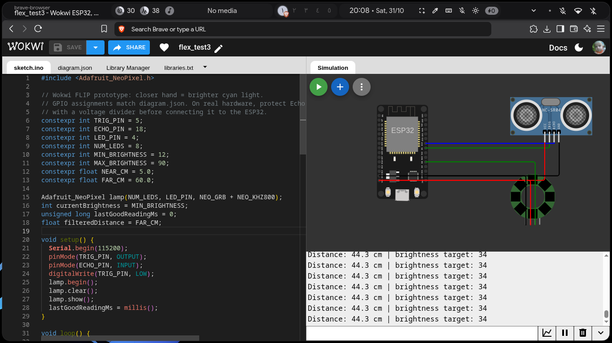

<h1>
<bold>Flex</bold>
</h1>

  

  <strong>A lamp that reacts to how far or close something is around it! (My first Hardware Project :)</strong>

  <a href="#demo">Demo</a> &bull;
  <a href="#components">Components used</a> &bull;

---

## Overview

Flex is a interactive lamp built for a @hackclub fallen project. Basically the lamp detects how close or far something is from it and changes its brightness based on the distance. The closer something is to the lamp the brighter it becomes!

## Demo

[Live Demo](https://wokwi.com/projects/479382185317182465) &mdash; Try the simulation!

## Components

1. ESP-32 Development board
2. HC-SR04 ultrasonic sensor
3. Eight Pixel WS2812B LED ring
4. Breadboard
5. 1kohm and 2kohm resistors
6. Male to Male Jumper wires
7. One 330 or 470 ohm resistor
8. One 500–1000µF capacitor, rated at least 6.3V
9. Regulated 5V 2A AC/DC power adapter
10. Diffuser and Enclosure Materials

